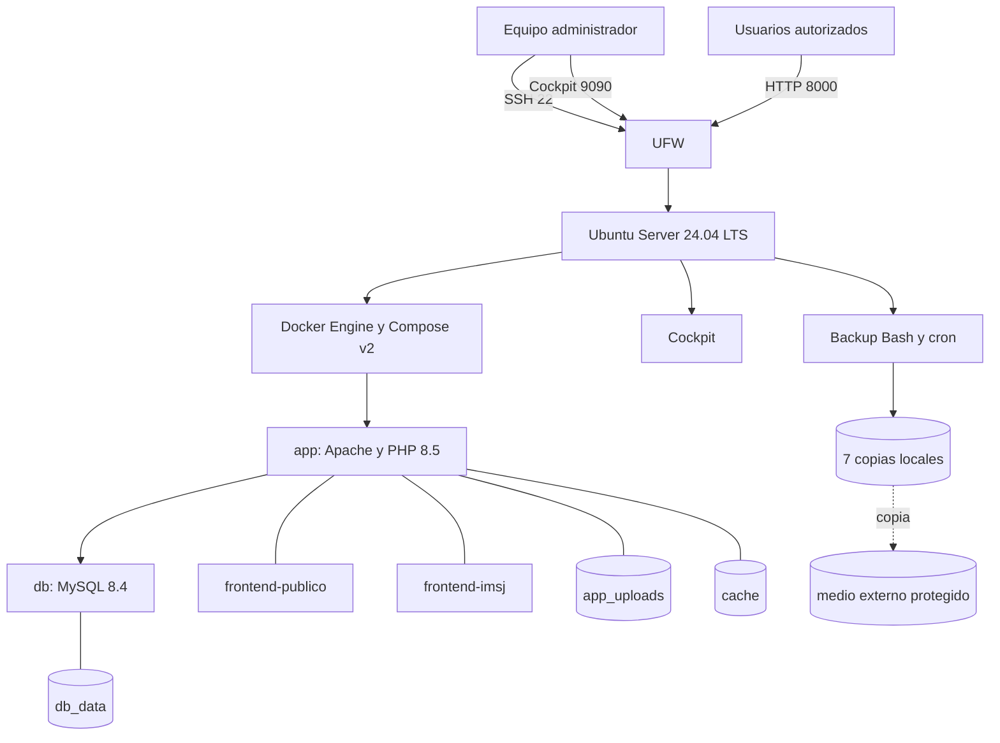
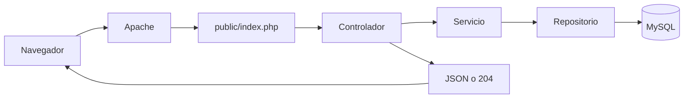

# Arquitectura propuesta de infraestructura

**Proyecto:** Educación Vial IMSJ - Portal Vial

**Servidor:** Ubuntu Server 24.04 LTS, 6 vCPU, 8 GB RAM y 50 GB SSD/NVMe

## 1. Vista general

El servidor concentra la administración del sistema operativo y Docker. Los usuarios solo acceden a Apache; MySQL permanece en la red interna de Compose.

## 2. Servidor anfitrión

| Elemento | Definición |
|---|---|
| Sistema operativo | Ubuntu Server 24.04 LTS de 64 bits |
| Recursos | 6 vCPU, 8 GB RAM y 50 GB SSD/NVMe |
| Nombre sugerido | `srv-imsj` |
| Red | IP fija configurada mediante Netplan |
| Administración | OpenSSH y Cockpit |
| Firewall | UFW con entradas denegadas por defecto |
| Contenedores | Docker Engine y Docker Compose v2 |
| Automatización | Bash y cron |

## 3. Componentes Docker

| Componente | Responsabilidad |
|---|---|
| `app` | Ejecutar Apache, PHP, la API y servir los dos frontends. |
| `db` | Mantener la base MySQL sin publicar el puerto 3306. |
| `db_data` | Conservar tablas, cuentas, contenidos, consultas, reservas e historial. |
| `app_uploads` | Conservar PDF e imágenes cargados. |
| `cache` | Conservar contadores compartidos de intentos de autenticación. |

Los contenedores utilizan `restart: unless-stopped`, límites de logs y controles de salud. `app` se ejecuta como `www-data`; `db`, como `mysql`. Ambos usan raíz de solo lectura, `no-new-privileges` y capacidades reducidas.

## 4. Red y acceso

| Origen | Destino | Puerto | Regla |
|---|---|---:|---|
| Red administrativa | Ubuntu Server | 22/TCP | SSH |
| Red administrativa | Ubuntu Server | 9090/TCP | Cockpit |
| Red autorizada | Aplicación | 8000/TCP | Portal, panel y API |
| `app` | `db` | 3306/TCP | Red interna Docker |

Compose publica la aplicación en `0.0.0.0:8000`. UFW determina qué redes pueden acceder. No se publica MySQL.

Para una demostración controlada se utiliza HTTP. Si el sistema se publica en Internet, se debe colocar un proxy inverso con HTTPS en 443/TCP, mantener la aplicación y MySQL detrás de él y reemplazar las URL de `.env` por el dominio institucional.

## 5. Recorrido de una petición

Los frontends consumen `/api` desde el mismo origen. Apache publica únicamente la entrada HTTP y los alias de los frontends; el resto del backend permanece fuera de `DocumentRoot`.

## 6. Persistencia y recuperación

El backup diario reúne:

- dump comprimido de MySQL;
- adjuntos del volumen `app_uploads`;
- copia del proyecto;
- configuración necesaria para reconstruir la instalación;
- manifiesto, versión y hashes SHA-256.

Se mantienen siete copias locales y una copia externa. La restauración se prueba con otro nombre de proyecto Compose y otro puerto para no tocar la instalación principal.

## 7. Monitoreo

| Nivel | Herramientas |
|---|---|
| Host | Cockpit, `uptime`, `free -h`, `df -h`, `ss -tulpn` |
| Servicios | `systemctl status docker`, `journalctl -u docker` |
| Contenedores | `docker compose ps`, `docker stats`, `docker compose logs` |
| Aplicación | `/api/health` y control de salud interno de Compose |
| Backups | `SHA256SUMS`, manifiesto y prueba de restauración |

## 8. Límites

- Los datos iniciales y su crecimiento son estimaciones y deben reemplazarse por mediciones reales.
- La instalación de laboratorio no representa una publicación institucional con dominio y HTTPS.
- El backup no se considera válido hasta completar una restauración aislada.

## Documentos relacionados

[Análisis de requerimientos](analisis-requerimientos.md), [justificación tecnológica](justificacion-tecnologica.md), [infraestructura](documentacion-infraestructura.md) y [reconstrucción](reconstruccion-infraestructura.md).
