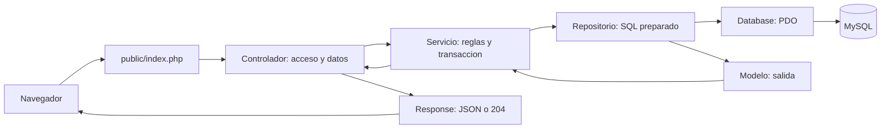
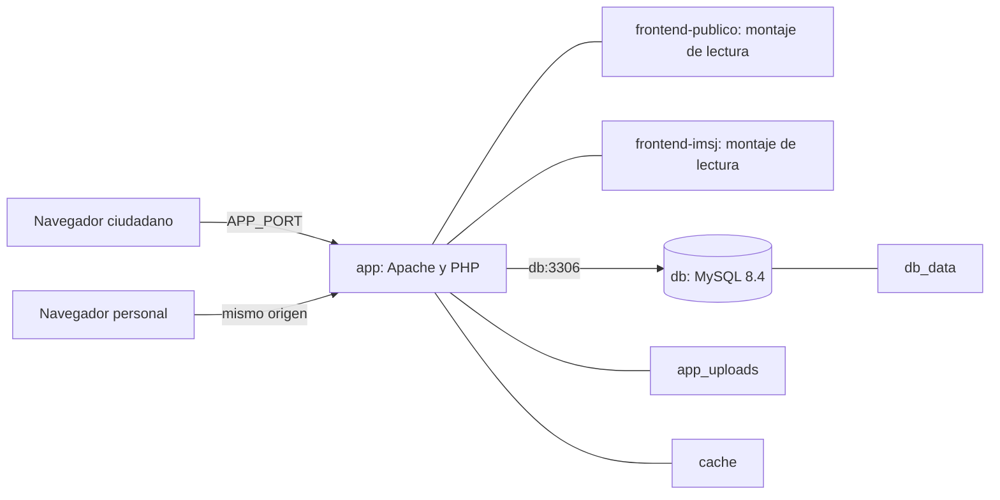

# Arquitectura del sistema y despliegue local

**Proyecto:** Educación Vial IMSJ — Portal Vial. **Actualización:** 21/10/2026.

**Base funcional:** backend PHP nativo; ocho módulos y 46 rutas HTTP.

## Componentes y responsabilidades

El sistema utiliza dos interfaces HTML/CSS/JavaScript: el portal público para la ciudadanía y el panel para personal y Directora. Ambas consumen una API común con PHP 8.5 y persistencia MySQL 8.4. El código de los frontends no accede directamente a la base de datos.

| Componente | Responsabilidad |
|---|---|
| Portal público | Consultar contenido publicado y vigente, practicar con simulacros y enviar consultas; operar reservas en la versión académica. |
| Panel IMSJ | Gestionar contenidos, aprobación, personal, consultas e historial; administrar agenda académica. |
| `public/index.php` | Cargar clases, resolver CORS y rutas, despachar al controlador y traducir excepciones a respuestas HTTP. |
| Controladores | Exigir sesión/rol, recibir datos, validar su forma y llamar al servicio. |
| Servicios | Resolver reglas de negocio, estados, transacciones y coordinación de datos y archivos. |
| Repositorios | Ejecutar consultas parametrizadas y obtener los registros necesarios. |
| Modelos y núcleo | Representar la salida, validar entradas y gestionar autenticación, conexión, respuesta y archivos. |
| MySQL y almacenamiento | Conservar datos relacionados, sesiones, historial y adjuntos. |

## Recorrido de una petición

Por ejemplo, la creación de una reserva recibe una franja y obtiene el usuario desde el token. El servicio inicia una transacción, bloquea la franja, verifica fecha, cupos y duplicación y solicita la inserción al repositorio. La respuesta devuelve los datos de la reserva. Si falla una comprobación no se guarda una reserva parcial.

Los ocho módulos son Auth, Consulta, Noticia, Material, Pregunta, Prueba, Reserva y Usuario. Reserva incluye franjas y agenda; Usuario incorpora el historial. La carga de clases es explícita y el despacho utiliza `switch`; no depende del arranque, ORM o middleware de Laravel.

## Topología de ejecución

Compose define únicamente `app` y `db`. Apache sirve la API desde `public/` y las interfaces mediante alias. Se publica `127.0.0.1:APP_PORT`, con 8000 por defecto. El navegador utiliza el origen de la página para construir las llamadas a `/api`, de modo que cambiar el puerto no exige editar JavaScript. MySQL no publica un puerto del host.

La raíz `/` redirige al portal. El alias de `login.html` resuelve el nombre histórico `Login.html` al ejecutarse sobre Linux. Las carpetas privadas del backend quedan fuera de `DocumentRoot`. Nginx se retiró y no existe un servicio separado de frontend en la configuración actual.

## Persistencia e integridad

`db_data` conserva las tablas; `app_uploads`, los PDF e imágenes; `cache`, los contadores de intentos. Estos volúmenes pertenecen al proyecto Compose elegido. Cambiar el nombre de proyecto puede crear volúmenes diferentes, aunque se ejecute el mismo código.

El esquema contiene once tablas del dominio y la tabla técnica `auth_tokens`. Las claves foráneas relacionan cuentas, reservas, franjas, noticias e historial. Las restricciones únicas evitan cédulas y reservas duplicadas. Las reservas utilizan además bloqueo de fila para verificar el último cupo con concurrencia real.

Los servicios de contenidos registran datos y auditoría en una transacción. Los archivos nuevos se eliminan si falla la operación; los sustituidos se retiran después de confirmar los datos. La cancelación ciudadana elimina la relación de reserva del propietario y libera capacidad; no conserva un estado histórico de cancelación.

## Autenticación y publicación

Las sesiones utilizan Bearer opaco y revocable; solo su hash SHA-256 se almacena en MySQL. El token vence a las ocho horas y cada petición protegida comprueba la cuenta activa y su rol. Los frontends lo guardan en `sessionStorage`.

Los contenidos siguen Borrador → Pendiente → Aprobado → Publicado. Solo Directora aprueba y la publicación requiere una acción posterior. Editar un contenido aprobado o publicado devuelve su estado a borrador. La API pública excluye los contenidos no publicados y filtra la vigencia de noticias.

## Controles del entorno

`app` se ejecuta como `www-data` y `db` como `mysql`. Ambos utilizan raíz de solo lectura y `no-new-privileges`. La aplicación conserva únicamente la capacidad de enlace al puerto HTTP; MySQL utiliza capacidades reducidas. Los volúmenes y rutas temporales proporcionan los espacios de escritura requeridos.

Apache configura CSP, protección anti-clickjacking, `nosniff` y respuestas de API con control de caché. Los recursos de iconos utilizados por el portal se sirven localmente. La publicación local se realiza en loopback.

## Parámetros institucionales

| Dato | Valor |
|---|---|
| Organismo administrador | Intendencia de San José |
| Responsable operativo | [] |
| Alojamiento | [] |
| Dominio | [] |
| Certificado HTTPS | [] |
| Contacto | [] |
| Frecuencia de respaldo | [] |
| Conservación de copias | [] |

## Fuentes

[Compose](../../backend/compose.yaml), [capas y clases](../programacion_full_stack/Justificación%20de%20clases,%20atributos%20y%20métodos.md), [modelo](../programacion_full_stack/Diagramas/README.md), [API](../../docs_auxiliares/backend/api.md) y [verificación](../../docs_auxiliares/evidencias/verificacion.md).
