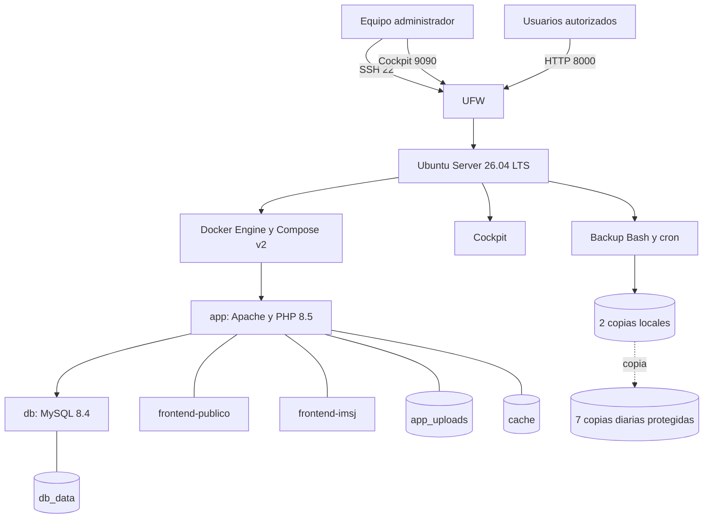
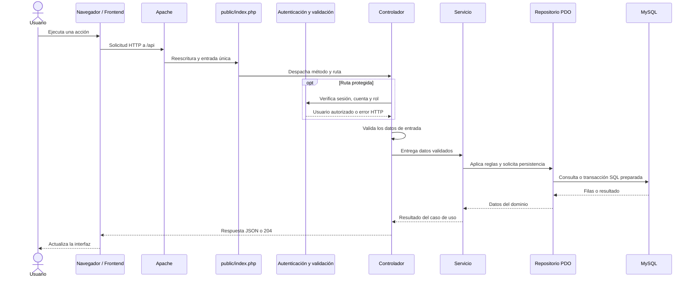

# Arquitectura propuesta de infraestructura

**Proyecto:** Educación Vial IMSJ - Portal Vial

**Servidor:** Ubuntu Server 26.04 LTS, 2 vCPU, 4 GB RAM y 30 GB SSD/NVMe

## 1. Vista general

El servidor concentra la administración del sistema operativo y Docker. Los usuarios solo acceden a Apache; MySQL permanece en la red interna de Compose.

## 2. Servidor anfitrión

| Elemento | Definición |
|---|---|
| Sistema operativo | Ubuntu Server 26.04 LTS de 64 bits |
| Recursos | 2 vCPU, 4 GB RAM y 30 GB SSD/NVMe |
| Capacidad de referencia | Objetivo inicial de 90 sesiones simultáneas, sujeto a prueba de carga y ampliación si un recurso supera 70 % sostenido |
| Nombre sugerido | `srv-imsj` |
| Red | IP fija configurada mediante Netplan |
| Administración | OpenSSH y Cockpit |
| Firewall | UFW con entradas denegadas por defecto |
| Contenedores | Docker Engine y Docker Compose v2 |
| Automatización | Bash y cron |

## 3. Componentes Docker

| Componente | Responsabilidad |
|---|---|
| `app` | Ejecutar Apache, PHP, la API y servir los dos frontends. |
| `db` | Mantener la base MySQL sin publicar el puerto 3306. |
| `db_data` | Conservar tablas, cuentas, contenidos, consultas, reservas e historial. |
| `app_uploads` | Conservar PDF e imágenes cargados. |
| `cache` | Conservar contadores compartidos de intentos de autenticación. |

Los contenedores utilizan `restart: unless-stopped`, límites de logs y controles de salud. `app` se ejecuta como `www-data`; `db`, como `mysql`. Ambos usan raíz de solo lectura, `no-new-privileges` y capacidades reducidas.

## 4. Red y acceso

| Origen | Destino | Puerto | Regla |
|---|---|---:|---|
| Red administrativa | Ubuntu Server | 22/TCP | SSH |
| Red administrativa | Ubuntu Server | 9090/TCP | Cockpit |
| Red autorizada | Aplicación | 8000/TCP | Portal, panel y API |
| `app` | `db` | 3306/TCP | Red interna Docker |

Compose publica la aplicación en `0.0.0.0:8000`. UFW determina qué redes pueden acceder. No se publica MySQL.

Para una demostración controlada se utiliza HTTP. Si el sistema se publica en Internet, se debe colocar un proxy inverso con HTTPS en 443/TCP, mantener la aplicación y MySQL detrás de él y reemplazar las URL de `.env` por el dominio institucional.

## 5. Recorrido de una petición

Los frontends consumen `/api` desde el mismo origen. Apache sirve los archivos públicos y dirige las rutas de API a `public/index.php`; el router identifica método y URL y selecciona el controlador. En las operaciones protegidas, el controlador solicita a `Auth` la verificación de sesión, cuenta y rol antes de modificar o exponer datos. El controlador valida la entrada específica, el servicio aplica reglas y transacciones, y el repositorio concentra las consultas PDO preparadas. La respuesta vuelve por esas capas hasta el navegador. Las rutas públicas omiten el paso de autenticación. El resto del backend permanece fuera de `DocumentRoot`.

## 6. Persistencia y recuperación

El backup diario reúne:

- dump comprimido de MySQL;
- adjuntos del volumen `app_uploads`;
- copia del proyecto;
- configuración necesaria para reconstruir la instalación;
- manifiesto, versión y hashes SHA-256.

La VM base conserva dos copias diarias locales y mantiene al menos siete copias diarias en un medio externo protegido. Si la política exige conservar siete backups completos dentro de la VM, el disco se amplía a 40–50 GB. La restauración se prueba con otro nombre de proyecto Compose y otro puerto para no tocar la instalación principal.

## 7. Monitoreo

| Nivel | Herramientas |
|---|---|
| Host | Cockpit, `uptime`, `free -h`, `df -h`, `ss -tulpn` |
| Servicios | `systemctl status docker`, `journalctl -u docker` |
| Contenedores | `docker compose ps`, `docker stats`, `docker compose logs` |
| Aplicación | `/api/health` y control de salud interno de Compose |
| Backups | `SHA256SUMS`, manifiesto y prueba de restauración |

## 8. Límites

- Los datos iniciales y su crecimiento son estimaciones y deben reemplazarse por mediciones reales.
- La capacidad de 90 usuarios simultáneos es un objetivo de dimensionamiento; debe confirmarse mediante una prueba de carga y observación en Cockpit antes de asumirla como capacidad operativa demostrada.
- Los 90 usuarios representan sesiones con períodos de lectura, no 90 solicitudes PHP activas permanentemente.
- Si CPU, memoria o disco superan de forma sostenida el 70 %, se deben ampliar los recursos o revisar la carga antes de la publicación.
- La instalación en red controlada no representa una publicación institucional con dominio y HTTPS.
- El backup no se considera válido hasta completar una restauración aislada.

## Documentos relacionados

[Análisis de requerimientos](analisis-requerimientos.md), [justificación tecnológica](justificacion-tecnologica.md), [infraestructura](documentacion-infraestructura.md) y [reconstrucción](reconstruccion-infraestructura.md).
