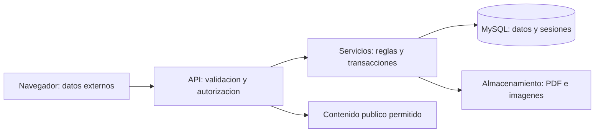

# Análisis de ciberseguridad

**Proyecto:** Educación Vial IMSJ — Portal Vial.

**Asignatura:** Electiva Ciberseguridad. **Actualización documental:** 20/10/2026.

## 1. Alcance del análisis

El análisis describe los activos, amenazas y controles de la versión PHP nativa y los relaciona con la evidencia disponible. Comprende el portal público, el panel IMSJ, la API, la base de datos, los archivos cargados y la infraestructura local Docker. La agenda y las reservas se evalúan como parte del alcance académico, aunque no formen parte de la entrega actual al cliente.

Se distinguen tres situaciones: control implementado en el código, resultado de una prueba registrada y actividad todavía pendiente. La presencia de validaciones o consultas preparadas no acredita por sí misma una auditoría completa. El registro técnico contiene pruebas HTTP/MySQL del 05/10 y arranque y demo del 13/10; los cambios del 20/10 requieren su propia revalidación funcional.

## 2. Activos y límites de confianza

| Activo | Información o función que debe protegerse | Consecuencia de un incidente |
|---|---|---|
| Cuentas y contraseñas | Identidad, rol y acceso al panel y a reservas propias. | Suplantación y ejecución de operaciones no autorizadas. |
| Tokens de sesión | Acceso temporal a las operaciones de la cuenta. | Uso de una sesión robada hasta su vencimiento o revocación. |
| Noticias, materiales y FAQ | Integridad, aprobación, publicación y vigencia de la información. | Difusión de contenido falso, interno o desactualizado. |
| Consultas ciudadanas | Nombre, correo y mensaje. | Exposición de datos o uso de la bandeja para abuso y contenido malicioso. |
| Banco del simulador | Enunciados, gráficos, opciones y respuestas correctas. | Alteración educativa o exposición anticipada de la solución. |
| Reservas y franjas | Relación de ciudadano, horario y cupo. | Cancelación ajena, duplicación o exceso de capacidad. |
| Historial | Usuario, acción, elemento y fecha. | Pérdida de trazabilidad o atribución incorrecta de acciones. |
| Adjuntos y respaldos | PDF, imágenes, exportaciones y configuración de instalación. | Pérdida de información, descarga indebida o ejecución de archivos inseguros. |

El navegador y sus datos se consideran entradas externas. Ocultar un botón no autoriza ni prohíbe una operación: la API debe comprobar la sesión y los permisos. La base y el almacenamiento se acceden desde el servidor; los archivos del backend fuera de `public` no deben publicarse como recursos estáticos.

## 3. Amenazas y efectos sobre el proyecto

| Amenaza | Escenario relevante | Impacto técnico y sobre usuarios |
|---|---|---|
| Inyección SQL | Entradas manipuladas en acceso, filtros y operaciones de administración. | Lectura o modificación de cuentas, contenidos y datos de ciudadanos si una consulta concatena entradas sin control. |
| XSS almacenado o reflejado | Texto, enlaces o mensajes incorporados al DOM sin codificación contextual. | Ejecución en el navegador, redirección, alteración visual o robo del token accesible a JavaScript. |
| Fuerza bruta y robo de credenciales | Intentos automatizados, claves previsibles o engaño al personal. | Acceso a una cuenta y acciones atribuidas a su identidad. |
| Fallas de autorización | Invocar directamente una ruta administrativa o un identificador de otra cuenta. | Publicación sin permiso, lectura de información interna o cancelación de reservas ajenas. |
| Archivos inseguros | Carga de un archivo ejecutable, contenido distinto del tipo declarado o ruta manipulada. | Ejecución, exposición de archivos privados o consumo indebido de recursos. |
| Pérdida de integridad | Falla parcial entre SQL, historial y adjuntos, o solicitudes simultáneas por el último cupo. | Registros inconsistentes, archivos huérfanos o más reservas que capacidad. |
| Exposición de configuración | Publicación de `.env`, SQL, mensajes internos, logs o respaldos. | Filtración de claves y datos y acceso a servicios de la instalación. |
| Falta de recuperación | Pérdida de volumen o copia sin adjuntos, configuración o versión compatible. | Interrupción del servicio e imposibilidad de reconstruir su estado. |

La valoración es cualitativa. No se dispone de la escala, metodología, fuente y responsable que justifiquen las puntuaciones de la matriz del PDF histórico. Esos valores no se presentan como una medición validada ni se reemplazan por números inventados.

## 4. Controles presentes y límites

| Área | Implementación disponible | Límite o evidencia adicional necesaria |
|---|---|---|
| Contraseñas | Hash bcrypt con costo 12 y `password_verify`; la salida del usuario omite el hash. | La política institucional de claves, recuperación y cuentas debe acordarse. El alta posterior de personal conserva una clave inicial fija. |
| Sesiones | Bearer opaco, secreto aleatorio de 32 bytes, hash SHA-256 y ocho horas de vigencia. Ingreso revoca sesiones previas; logout y desactivación revocan tokens. | `sessionStorage` es accesible a scripts del mismo origen; la prevención de XSS y HTTPS son necesarias en el entorno real. |
| Roles | Comprobación de cuenta activa y rol en cada operación protegida; Directora hereda acceso de personal y es la única que aprueba. | La asignación y revisión institucional de permisos no se deduce de las cuentas de demostración. |
| Intentos de acceso | Cinco intentos por minuto por IP y operación para login/registro, con contador y bloqueo de archivo compartido. | No es un limitador general de todas las rutas; varias instancias necesitan caché compartida. |
| SQL e integridad | PDO preparado, transacciones, claves foráneas y restricciones únicas. Reserva bloquea la franja antes de comprobar cupo. | La parametrización no sustituye los permisos y las reglas de negocio. |
| Entradas y errores | `Solicitud` valida JSON/multipart, tipos, tamaños, opciones, fechas, horas, cédulas y URL. Los errores internos no devuelven SQL o claves. | La validación del navegador es complementaria. Se debe revisar cada contexto de salida de HTML y URL. |
| Archivos | MIME/contenido, límites por recurso, nombres aleatorios y rutas restringidas fuera de `public`. | VIDEO usa URL externa; los proveedores y sus condiciones deben definirse para la operación institucional. |
| Publicación | Estados Borrador, Pendiente, Aprobado y Publicado; edición devuelve a borrador y noticias se filtran por vigencia. | Una aprobación técnica de contenido no es una aceptación del proyecto. |
| Auditoría | Operaciones administrativas guardan usuario, acción, fecha y elemento en la misma transacción de datos. | No conserva valores anterior/nuevo; cobertura total y retención están por acordar. La cancelación ciudadana elimina la reserva sin estado histórico. |
| Infraestructura | MySQL sin puerto del host, frontends montados en lectura y raíz Apache limitada a `public`. | La configuración local no incorpora dominio ni HTTPS de producción; falta evidencia final de hardening y recuperación. |

## 5. Superficies específicas

### Contenidos y consultas

Noticias, materiales y FAQ se administran con sesión y permisos. El portal solo debe consumir la representación pública. La bandeja de consultas contiene datos personales y su lectura requiere acceso de personal; el formulario público no expone su listado. La revisión de salida debe considerar los módulos que utilizan `innerHTML`, además de los que construyen nodos con `textContent`.

### Simulacro

La consulta pública omite la respuesta correcta. La corrección obtiene la solución desde la base, sin aceptar del navegador una marca de respuesta verdadera. Las imágenes admitidas son JPG, PNG y WEBP de hasta 2048 KB. Debe comprobarse tanto la carga válida como el rechazo de contenido ejecutable y la descarga del recurso almacenado.

### Agenda académica

La reserva se asocia a la cuenta del token. La transacción y el bloqueo impiden superar el cupo por solicitudes simultáneas, y la unicidad evita duplicación por ciudadano/franja. La ruta DELETE comprueba el propietario; personal recibe rechazo de rol y otra cuenta ciudadana no puede eliminar el registro. El borrado libera capacidad y no conserva un historial de cancelación.

Los listados solo muestran fechas vigentes; ese filtro de presentación no elimina los registros pasados ni define su conservación. La política de retención debe contemplar datos efectivamente guardados, no solo lo que la interfaz permite ver.

## 6. Evidencia disponible y trabajo pendiente

| Bloque | Referencia actual | Estado de cierre |
|---|---|---|
| Funciones, permisos, archivos y concurrencia | Suite HTTP/MySQL y registro del 05/10. | Resultados históricos disponibles para su versión y entorno. |
| Consultas, Directora, gráficos y Docker | Demo del 13/10, con 41 comprobaciones HTTP y revisión visual. | Ejecución técnica registrada; no equivale a despliegue institucional. |
| Cancelación y ajustes del 20/10 | Casos incorporados a la suite y revisión de sintaxis. | Falta una nueva ejecución integral documentada sobre este corte. |
| SAST, DAST y auditoría API | Actividades enumeradas en el checklist de entrega. | Informes finales, hallazgos y revalidación todavía sin incorporar. |
| Respuesta a incidentes | Necesidad identificada. | Faltan procedimiento institucional, responsables y evidencia de ejercicio. |
| Privacidad y términos | PDF con datos y decisiones pendientes. | Completar con la Intendencia antes de presentarlos como definitivos. |
| Restauración y operación real | Guía de respaldo y reconstrucción. | Falta ensayo de recuperación y definición institucional de conservación y responsables. |

## 7. Condiciones de evaluación final

El informe de seguridad de la entrega debe identificar versión, entorno, alcance autorizado, herramienta y configuración, procedimiento, resultado y ubicación de evidencia. Cada hallazgo debe relacionar impacto, corrección o decisión y nueva prueba. No se completan casillas de ejecución a partir de un resultado esperado.

El [checklist de ciberseguridad](checklist_ciberseguridad_entrega_final.md) organiza las actividades pendientes. El [registro técnico](../../docs_auxiliares/evidencias/verificacion.md) conserva resultados de ejecuciones anteriores. El PDF de este análisis mantiene una versión previa; esta actualización Markdown no modifica sus páginas.

## 8. Referencias

- [Requisitos](../ingenieria_software/Requerimientos.md), [arquitectura](../administracion_ssoo/arquitectura_propuesta.md), [infraestructura](../administracion_ssoo/documentacion-infraestructura.md) y [contrato de API](../../docs_auxiliares/backend/api.md).
- [OWASP SQL Injection](https://owasp.org/www-community/attacks/SQL_Injection).
- [OWASP XSS Prevention](https://cheatsheetseries.owasp.org/cheatsheets/Cross_Site_Scripting_Prevention_Cheat_Sheet.html).
- [OWASP Authentication](https://cheatsheetseries.owasp.org/cheatsheets/Authentication_Cheat_Sheet.html) y [Authorization](https://cheatsheetseries.owasp.org/cheatsheets/Authorization_Cheat_Sheet.html).
- [OWASP Input Validation](https://cheatsheetseries.owasp.org/cheatsheets/Input_Validation_Cheat_Sheet.html) y [Password Storage](https://cheatsheetseries.owasp.org/cheatsheets/Password_Storage_Cheat_Sheet.html).
- [OWASP Logging](https://cheatsheetseries.owasp.org/cheatsheets/Logging_Cheat_Sheet.html) y [File Upload](https://cheatsheetseries.owasp.org/cheatsheets/File_Upload_Cheat_Sheet.html).
