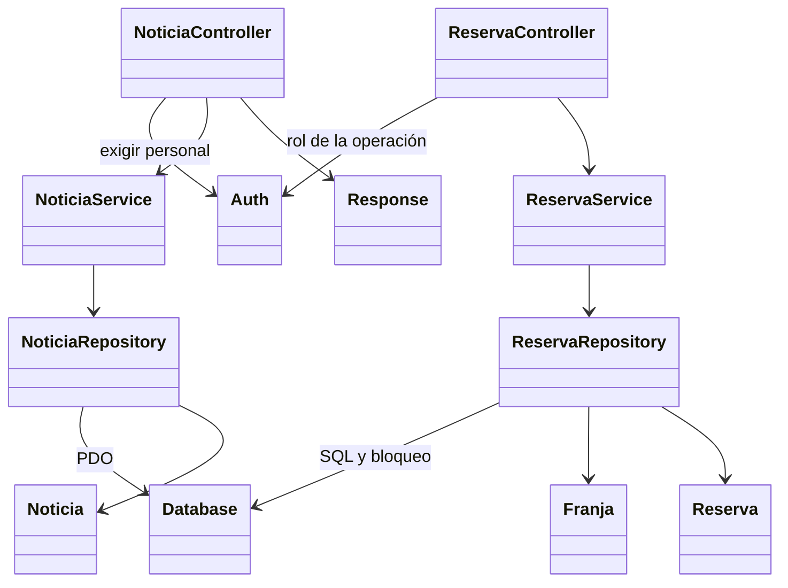

# Diagramas del proyecto y responsabilidades actuales

**Actualización - 14/10/2026.** Se separan el modelo conceptual y el modelo relacional para evitar presentar claves foráneas o tablas como si fueran parte del MER.

## Modelo entidad–relación conceptual

El MER utiliza notación conceptual: rectángulos para entidades, rombos para relaciones, óvalos para atributos y cardinalidades mínimas/máximas. Los identificadores aparecen subrayados; no se muestran `PK`, `FK`, tipos SQL, índices ni tablas técnicas.

La reserva se representa como una entidad asociativa: un usuario puede realizar muchas reservas y cada reserva corresponde a una sola franja de disponibilidad; una franja puede recibir muchas reservas. `auth_tokens` no aparece porque es un mecanismo técnico de autenticación.

## Pasaje a tablas

El modelo relacional incorpora las claves primarias, foráneas y únicas. También incluye `consultas`, la imagen opcional de las preguntas de prueba y la tabla técnica `auth_tokens`, de acuerdo con [database.sql](../../backend/database.sql).

Las reglas aplicadas y la notación textual de todas las tablas están en [Pasaje del MER al modelo relacional](PASO_A_TABLAS.md).

## UML histórico y recorrido actual

La nota del PNG sobre CRUD/corrección en controladores es incompleta: el controlador atiende HTTP, el servicio coordina negocio y el repositorio ejecuta SQL. Ya no existen interfaces/Eloquent del backend anterior. Los modelos actuales representan datos y salida JSON.

Franjas y agenda pertenecen al módulo Reserva; historial al módulo Usuario; las consultas ciudadanas forman el módulo Consulta. Hay ocho controladores, ocho servicios y ocho repositorios. Esta vista muestra ejemplos representativos, no todas las clases o endpoints. [Modelo y justificación](../Justificación%20de%20clases,%20atributos%20y%20métodos.md), [arquitectura](../arquitectura_propuesta.md).
