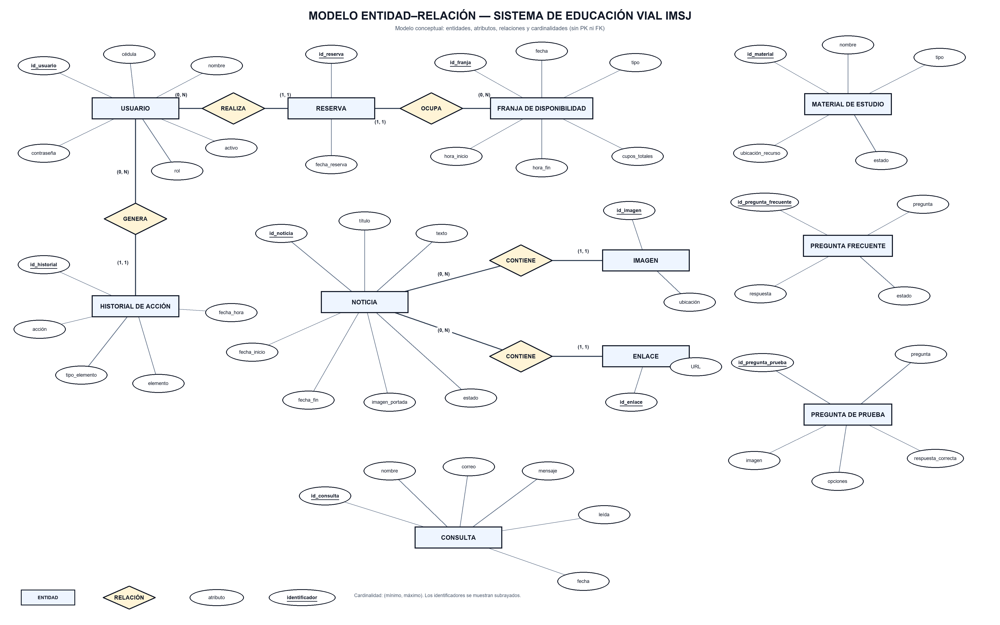
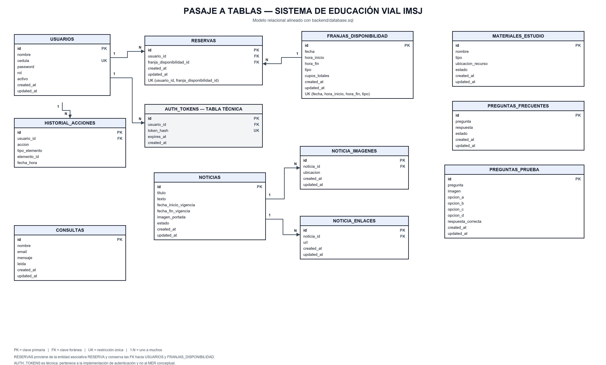
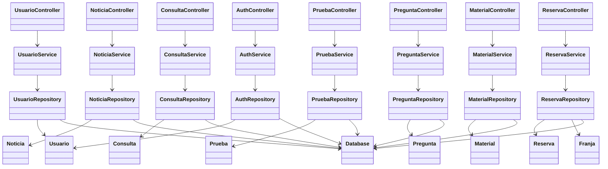
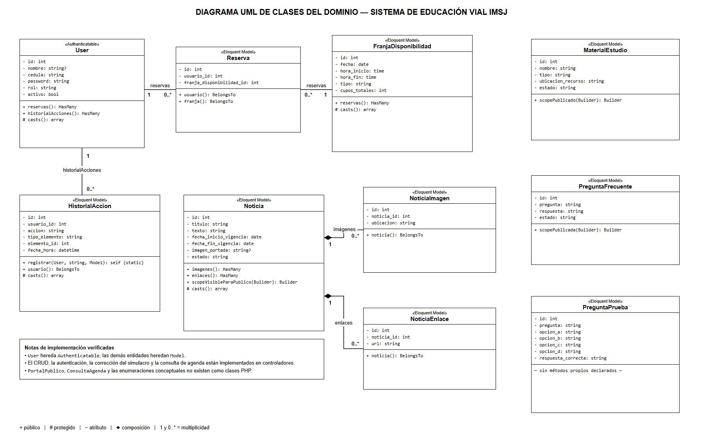

# Diagramas del proyecto y responsabilidades actuales

**Actualización - 14/10/2026.** Se separan el modelo conceptual y el modelo relacional para evitar presentar claves foráneas o tablas como si fueran parte del MER.

## Modelo entidad–relación conceptual

El MER utiliza notación conceptual: rectángulos para entidades, rombos para relaciones, óvalos para atributos y cardinalidades mínimas/máximas. Los identificadores aparecen subrayados; no se muestran `PK`, `FK`, tipos SQL, índices ni tablas técnicas.

La reserva se representa como una entidad asociativa: un usuario puede realizar muchas reservas y cada reserva corresponde a una sola franja de disponibilidad; una franja puede recibir muchas reservas. `auth_tokens` no aparece porque es un mecanismo técnico de autenticación.

## Pasaje a tablas

El modelo relacional incorpora las claves primarias, foráneas y únicas. También incluye `consultas`, la imagen opcional de las preguntas de prueba y la tabla técnica `auth_tokens`, de acuerdo con [database.sql](../../../backend/database.sql).

Las reglas aplicadas y la notación textual de todas las tablas están en [Pasaje del MER al modelo relacional](PASO_A_TABLAS.md).

## Diagrama de clases del backend nativo

La vista siguiente describe las dependencias de los ocho módulos actuales. Cada controlador llama a su servicio y cada servicio a su repositorio; la conexión se comparte mediante Database. Los modelos representan registros y salida JSON, sin herencia de Eloquent.

Los controladores utilizan Auth para exigir acceso y Response para responder. Solicitud reúne las reglas comunes de entrada y Archivo valida, guarda y elimina adjuntos. Franjas y agenda pertenecen al módulo Reserva; historial pertenece a Usuario y las consultas forman el módulo Consulta.

## Correspondencia e integridad

El modelo relacional contiene doce tablas: once del dominio y `auth_tokens`. `usuarios.cedula` y el hash del token son únicos. La combinación usuario/franja impide duplicación de reservas y la combinación fecha, inicio, fin y tipo identifica una franja sin duplicados exactos. Las relaciones de noticias tienen eliminación en cascada; reservas e historial conservan sus referencias mediante claves foráneas.

Las FAQ utilizan pregunta, respuesta y estado. Las consultas conservan el mensaje y su marca de lectura. La cancelación académica elimina la reserva. Los gráficos de preguntas se guardan como ruta en `preguntas_prueba.imagen`.

## Antecedente UML

El PNG corresponde al antecedente de modelado. La estructura PHP nativa se desarrolla en la vista de clases y en la [justificación de responsabilidades](../Justificación%20de%20clases,%20atributos%20y%20métodos.md), la [arquitectura](../../administracion_ssoo/arquitectura_propuesta.md) y el [esquema SQL](../../../backend/database.sql).
