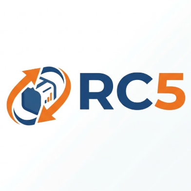

# Aclaraciones y datos pendientes del proyecto

**Proyecto:** Educación Vial IMSJ
**Fecha de actualización:** 20/10/2026.

**Equipo:** Tomás Cabrera, Juan Robaina, Gabriela Romero, Verónica Romero y Juan Corrales.
**Revisión interna de documentación:** Juan Robaina. El estado de los cambios funcionales se registra por separado: **CC-01–CC-05, Listos**.

Este documento reúne las aclaraciones proporcionadas por el grupo y los datos institucionales que todavía deban completarse. No reemplaza las actas ni modifica el estado de los cambios, que se encuentra consolidado como **Listo**. El crédito del proyecto y su documentación corresponde a los integrantes del grupo. El registro de herramientas se concentra en la declaración del proyecto.

## 1. Información aclarada por el grupo

### Equipo y responsabilidades

| Integrante | Responsabilidad confirmada |
|---|---|
| Tomás Cabrera | Líder de proyecto y desarrollador backend. |
| Juan Robaina | Testing, documentación y revisión interna de documentos. |
| Gabriela Romero | Base de datos. |
| Verónica Romero | Desarrollo frontend. |
| Juan Corrales | Desarrollo frontend. |

La distribución anterior no asigna automáticamente responsables a tareas concretas ni a áreas adicionales, como seguridad o infraestructura. Esas asignaciones se registran cuando el equipo las acuerde.

### Cliente y forma de trabajo

| Aspecto | Aclaración confirmada |
|---|---|
| Referente del cliente | **Inspector de Tránsito de la Intendencia**, conocido como Nacho. Se utiliza principalmente el cargo; el apellido no está confirmado y no se inventa. |
| Autoridad del referente | Puede aceptar entregas y aprobar cambios de alcance. |
| Registro de aprobaciones y cambios | En las actas de reunión, donde el Inspector aprueba o solicita cambios. |
| Coordinación, revisión de cambios y avances | Se realizan en reuniones y se documentan en las actas. |
| Trabajo de las actas | Queda a cargo del equipo. El contenido de las actas se completa a partir de los registros y correcciones del equipo. |
| Administración y mantenimiento después de la entrega real | A cargo de la Intendencia, por ahora. No se atribuye ese trabajo a una persona o proveedor no confirmado. |
| Contacto institucional | Se completará posteriormente en los términos y la política de privacidad. |

### Alcance y estado de los cambios

Las agendas son el único módulo señalado por el grupo como exclusivamente académico. **Estado consolidado al 15/10/2026: CC-01–CC-05, Listos.**

| Cambio | Solicitud | Estado informado por el grupo | Destino |
|---|---|---|---|
| CC-01 | Simulacros de pruebas teóricas. | **Listo.** | Entrega real. |
| CC-02 | Formulario de consultas en el pie del sitio y lectura en el panel IMSJ. | **Listo.** Origen: reunión/demo del 03/09 con Directora e Inspector. | Entrega real. |
| CC-03 | Validación por la Directora y estados Borrador, Pendiente, Aprobado y Publicado; aprobación separada de publicación. | **Listo.** Origen: reunión/demo del 03/09 con Directora e Inspector. | Entrega real. |
| CC-04 | Material gráfico adjunto a preguntas de los test. | **Listo.** Origen: reunión/demo del 03/09 con Directora e Inspector. | Entrega real. |

El rol **Directora** pertenece al sistema y a la solicitud CC-03. No debe confundirse con la función de Juan Robaina como aprobador interno de documentación, ni con la autoridad del Inspector para aceptar entregas.

### Decisión tecnológica CC-05

**Confirmada por el grupo el 02/10/2026; estado Listo:** retirar Laravel y usar PHP sin framework, capas y PDO/MySQL. El 05/10/2026 el grupo precisó el uso de api-simple y la reescritura desde cero. Código, configuración y pruebas HTTP/MySQL están implementados.

Se conserva el contrato de los frontends y el dominio IMSJ. Cookie JWT, rutas/JSON del ejemplo, productos y datos de demostración no se adoptaron. La [guía CC-05](../backend/migracion_backend_vanilla.md) y el [análisis de referencia](../backend/referencia_api_completa.md) describen las diferencias. CC-01–CC-05 están Listos.

## 2. Datos para completar por el equipo

Las filas siguientes identifican información o evidencia ausente; no asignan nuevas tareas, fechas ni métodos de trabajo. El equipo puede completar la última columna con el dato confirmado y un enlace al documento, acta o evidencia correspondiente. Si algo todavía no se decidió, debe conservarse como pendiente.

### Actas y registros históricos

La elaboración de [actas de reunión](../../docs/ingenieria_software/actas_reuniones.md) y [Sprint Review](../../docs/ingenieria_software/actas_sprint_review.md) queda íntegramente a cargo del equipo. Corresponde completar fechas, participantes, acuerdos, desacuerdos, aprobaciones o cambios pedidos por el Inspector y las tareas o plazos efectivamente acordados. No se reconstruyen esos hechos a partir del código ni se atribuyen a reuniones pasadas las aclaraciones de esta conversación.

| ID | Información por completar | Documento relacionado | Dato confirmado / evidencia |
|---|---|---|---|
| P-01 | Fecha, entrevistadores, participantes y evidencia de validación del relevamiento inicial. | [Informe de entrevista](../../docs/ingenieria_software/informe%20entrevista.md). | R-01 corregida: 09/07, 16:05–16:45, presencial, Tomás Cabrera, Juan Robaina e Inspector. Falta confirmar correspondencia y validación del informe. |
| P-02 | Actas y referencias concretas de decisiones, aprobaciones, cambios y seguimiento. | Actas y Sprint Review, a cargo del equipo. | R-01–R-05 disponibles y desarrolladas; quedan horarios R-02–R-05, redactor, validaciones y tareas históricas sin registro. |
| P-03 | Planificación realmente acordada, tareas por integrante y relación con las US. Los períodos y puntos reconstruidos no son compromisos certificados. | [Planning](../../docs/ingenieria_software/sprint_planning.md) y [backlog](../../docs/ingenieria_software/backlog.md). | Roles generales confirmados; capacidad, estimaciones y compromisos por historia pendientes de registro. |
| P-04 | Evidencia del flujo Git utilizado y de los reportes académicos que exige la consigna. No se establece una estrategia nueva. | [Revisión documental](revision_documental.md). | Pendiente de aportar referencias concretas del equipo en el formulario. |

### Definiciones y datos por completar

| ID | Información por completar | Documento relacionado | Dato confirmado / evidencia |
|---|---|---|---|
| P-05 | CC-01: cantidad y selección de preguntas, duración si corresponde, criterio de resultado y responsable del banco. Los valores actuales del código no sustituyen acuerdos. | [Control de cambios](../../docs/ingenieria_software/control_cambios.md), RF22 y US31. | Listo: hasta diez preguntas aleatorias, cuatro opciones, total/aciertos; sin temporizador ni umbral. Responsable institucional del banco sin registro. |
| P-06 | CC-02: campos del formulario, permisos para leer consultas y tratamiento/conservación de los datos. La solicitud no incorpora por sí sola respuestas o notificaciones. | Control de cambios, RF23 y US32. | Listo: nombre, correo y mensaje; lectura por personal/Directora y marca de leído. Retención y tratamiento institucional pendientes. |
| P-07 | CC-03: contenidos afectados, quién envía/aprueba/publica, tratamiento del rechazo y de cambios posteriores a la aprobación. | Control de cambios, RF21 y US30. | Listo: noticias, materiales y FAQ; personal prepara/envía/publica, solo Directora aprueba y editar devuelve a borrador. No se incorpora un acuerdo histórico de rechazo no registrado. |
| P-08 | CC-04: formatos, cantidad y tamaño de adjuntos, obligatoriedad y presentación al resolver el test; solicitante concreto si puede documentarse. | Control de cambios, RF24 y US33. | Listo: una imagen opcional JPG/PNG/WEBP de hasta 2048 KB; origen en la reunión del 03/09 con Directora e Inspector. |
| P-09 | Categorías de preguntas frecuentes y acuerdo sobre subir o enlazar videos. Reglas de agenda y costo urgente únicamente para la entrega académica. | [Requerimientos](../../docs/ingenieria_software/Requerimientos.md), RF19/RF20 y requisitos de agenda. | Pendientes categorías concretas, modalidad de video acordada y costo urgente; el código actual utiliza URL para VIDEO. |

### Entrega, operación y evidencia

| ID | Información por completar | Documento relacionado | Dato confirmado / evidencia |
|---|---|---|---|
| P-10 | Forma concreta de separar la entrega real de la agenda académica; versión que se entregará y entorno de instalación. | [Charter](../../docs/ingenieria_software/project_charter.md) y [arquitectura](../../docs/administracion_ssoo/arquitectura_propuesta.md). | B-02 selecciona la demo del 13/10 para PDF; el código del 20/10 añade cancelación. Separación de versiones e instalación institucional por definir. |
| P-11 | Área o referente operativo dentro de la Intendencia, alojamiento, dominio y configuración de producción cuando se definan. La administración y mantenimiento institucionales ya están aclarados. | Arquitectura y [SSOO](../../docs/administracion_ssoo/README.md). | Pendiente de definición por la Intendencia; la responsabilidad institucional ya está confirmada. |
| P-12 | Resultados de pruebas por versión, entorno, responsable y evidencia; validaciones móviles, de accesibilidad y seguridad pendientes. | [Verificación](../evidencias/verificacion.md) y [seguridad](../../docs/electiva_ciberseguridad/analisis_ciberseguridad.md). | Hay resultados del 05/10 y 13/10; faltan informes finales de seguridad, móvil, accesibilidad y revalidación funcional del corte del 20/10. |
| P-13 | Evidencia de reconstrucción y restauración de respaldos; manual de usuario, entrega y aceptación final cuando correspondan. | SSOO, verificación y actas del equipo. | Arranque Docker aislado disponible; restauración institucional, manual y cierre sin documento o evidencia completos. |

### Datos institucionales, autoría y revisión

| ID | Información por completar | Documento relacionado | Dato confirmado / evidencia |
|---|---|---|---|
| P-14 | Contacto oficial, identificación institucional, domicilio y demás campos del borrador; proveedores/alojamiento, finalidades, conservación y tratamiento de menores por confirmar con la institución. | [Política de privacidad](../../docs/electiva_ciberseguridad/Politica_de_Privacidad_IMSJ_Uruguay.pdf) y [términos](../../docs/electiva_ciberseguridad/Terminos_y_Condiciones_IMSJ_Uruguay.pdf). | La Intendencia administrará; C-02 no aporta RUT y C-03 no confirma domicilio institucional. Contactos y decisiones de tratamiento pendientes. |
| P-15 | Titular de los derechos y denominación que debe figurar en la licencia; el archivo actual usa una denominación distinta de la Intendencia. | [LICENSE](../../LICENSE). | Titularidad pendiente de confirmación; la licencia se conserva sin cambios. |
| P-16 | Revisión interna de esta actualización por Juan Robaina; detalle histórico de asistencia de IA y firmas de cada integrante que correspondan. Su función de revisor no acredita una aprobación ya realizada. | [Declaración de IA](../../docs/ingenieria_software/declaracion_etica_ia.md). | Declaración actualizada; conformidades individuales y referencias concretas de revisión humana pendientes de registro. |

## 3. Datos de implementación de CC-05 por completar

| ID | Información por completar | Base documentada | Dato confirmado / evidencia |
|---|---|---|---|
| P-17 | Sustitución de Laravel indicada en la letra. | Decisión aplicada mediante CC-05. | **Listo.** PHP nativo/PDO. |
| P-18 | Mecanismo PHP de autenticación, almacenamiento/revocación y transición de sesiones/tokens existentes. | Preservar contrato Bearer y garantías observadas. | **Listo.** Bearer opaco revocable, hash SHA-256, ocho horas; nuevo login tras transición. |
| P-19 | Revisión del árbol y configuración implementados. | PHP 8.5, PDO, sin paquetes externos; ocho módulos actuales, con manifiesto de extensiones. | **Listo.** |
| P-20 | Ensayo de instalación Docker y actualización/restauración con copia de datos y adjuntos. | Procedimientos documentados en [SSOO](../backend/transicion_backend_vanilla.md); SQL sin DROP ni demo. | Arranque Docker aislado del 13/10 registrado; restauración de respaldo y actualización institucional requieren evidencia específica. |
| P-21 | Asignación/estimación de TM-01–TM-07, versión migrada, pruebas V-CC05 y revisión documental. | Roles generales confirmados; compromisos en reuniones/actas del equipo. | Versión y pruebas técnicas referenciadas; asignaciones, estimaciones y compromisos individuales históricos sin registro. |

Las alternativas que cambien autenticación visible, formato JSON, rutas, puertos o reglas del producto requieren decisión previa del grupo. La migración de framework ya fue solicitada; no se pide aprobar de nuevo esa decisión.

## 4. Estado y procedencia de los datos

Una definición confirmada identifica su fuente; un dato pendiente no se completa por deducción. Las respuestas se mantienen en el formulario y después se integran al documento correspondiente. Los resultados de pruebas se consultan con su fecha, versión y entorno.

## Evidencia nueva y datos que todavía faltan - 05/10/2026

Las pruebas HTTP/MySQL de la versión nativa están en [verificación](../evidencias/verificacion.md). CC-01–CC-05 están Listos. Los demás campos P corresponden a datos institucionales, legales u operativos independientes del estado de esos cambios.

La estructura y autenticación PHP ya están implementadas; los campos P-18/P-19 requieren revisión/evidencia final, no volver a elegir arbitrariamente el contrato. Las actas se completan por el equipo en reuniones y no se modificaron aquí.

## Consolidación disponible al 20/10/2026

Portal Vial es el nombre público y la identidad RC5 utiliza naranja y azul. El inicio del proyecto se sitúa en julio. La decisión de retirar Laravel se informa el 30/09 y el control mantiene su registro del 02/10. La cancelación se añadió a la agenda académica el 20/10 y la API tiene 46 rutas.

R-01 registra ahora 09/07, modalidad presencial, horario 16:05–16:45 y presencia de Tomás Cabrera, Juan Robaina e Inspector de Tránsito. El informe de entrevista todavía requiere confirmar su correspondencia y validación. Los demás horarios y tareas históricas siguen sujetos a registros del equipo.

El formulario conserva respuestas institucionales incompletas: no hay RUT, domicilio confirmado, contactos, proveedores ni retención definidos. Los documentos se desarrollan con esa limitación explícita, sin presentar como aprobado lo que todavía necesita una fuente.
